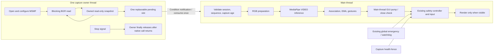

# Phase 3.10 — Experimental latest-frame camera capture

## Investigation recorded before implementation

Initial repository state: clean `main`, commit
`6dacecd1a784412d7eccc2eae33811c17a68522f`. Baseline: camera 16, gestures 165,
hand tracking 230, controls 259: **670 passing tests**.

The existing `run()` initializes the safety controller (disarmed), CPU VIDEO
landmarker, and MSMF capture on the main thread. It requests MJPG, 1920×1080 and
60 FPS via the existing shared camera configuration function. It does not change
autofocus. Readback is diagnostic, not proof of physical sensor delivery rate.
The same thread reads BGR, resizes/converts RGB into reused buffers, runs inference,
associates/smooths hands, extracts features, recognizes static/pinch/swipe events,
pumps HighGUI, checks preview ownership/lifecycle, updates the controller, then
renders if visible. The emergency/watchdog thread is already independent in live
mode. Minimize skips drawing; X disarms before resource cleanup.

`read_frame()` raises on failed/empty reads. There is no reconnect or application
read deadline; synchronous native read/model calls can delay the main thread.
ExitStack owns normal release, and process_frames finally disarms/releases input.
Existing 250 ms temporal-gap cancellation and host observation-age guards remain
the safety basis. No model/recognition/controller thresholds will be changed.

The owner's historical two-hand measurements (25.69 FPS minimal, 25.51 FPS full
gestures; about 15.3 ms read + 23.5–23.8 ms processing) motivate overlapping capture.
They are owner-supplied hardware results, not fresh measurements from this task.
Any synthetic overlap benchmark will be reported separately.

The new capture source can be injected at the existing read boundary. It must
open/configure/read/query/release VideoCapture on one owning thread, hand off one
immutable snapshot, and leave MediaPipe, HighGUI and controller updates on main.
No inference thread, multiprocessing, LIVE_STREAM migration or dependency update.

### Native blocking constraint

Upstream [OpenCV MSMF source](https://github.com/opencv/opencv/blob/4.x/modules/videoio/src/cap_msmf.cpp)
contains a 10-second video sample wait; its property switch does not expose
`CAP_PROP_READ_TIMEOUT_MSEC`. [OpenCV video-I/O documentation](https://docs.opencv.org/4.x/d4/d15/group__videoio__flags__base.html)
documents that timeout for FFmpeg/GStreamer. This source inspection is not a
guarantee that every installed driver/native call returns within ten seconds.
Python cannot safely terminate a stuck native read under the requested constraints.
The design must use cooperative stop, owner-only release, bounded join and an
explicit shutdown-failure report. A daemon flag can only be the final process-exit
safeguard, never the normal cleanup mechanism. Camera sessions that have not
released must not be reopened in the same process.

## Experimental architecture

`--capture-pipeline sync` is the default and creates no capture thread. Its camera
open/configuration, read boundary, timestamp conversion and processing order stay
on main. `--capture-pipeline latest-thread` explicitly selects the experiment.



The producer owns VideoCapture construction, `isOpened`, configuration/property
queries, all reads, release and final native-object destruction. The camera object
is never passed to main. The worker receives no model, renderer or controller.
Main keeps all inference, recognition, controller updates and HighGUI work.
There is no inference worker, multiprocessing, unbounded FIFO or LIVE_STREAM mode.

The handoff uses a condition variable and one optional `CapturedFrame`: random
session generation, increasing sequence, monotonic host read-completion time,
read duration, publication time, dimensions and BGR array. Consumption clears the
slot atomically. A new publication replaces an unconsumed snapshot and increments
an overwrite counter. Replacements are intentional application drops, not measured
sensor/driver losses. A consumed sequence cannot be returned again.

One defensive contiguous BGR copy per publication prevents corruption when a
backend reuses its read storage. The owned array is read-only, and main performs
no second handoff copy. This preserves data integrity at a measurable memory/CPU
cost; it is not a zero-copy claim. A consumed image, one pending image, and native/
in-flight copy storage can coexist, but no queue of old observations accumulates.
The application slot is capacity one; internal driver queues remain outside it.

Shared packet/state/counters use the condition lock. Native reads, full-image
copies, camera initialization/release and controller callbacks never hold it.
The health check takes only a short metadata lock. There is no producer acquisition
of a controller lock, hence no capture/controller lock cycle. Condition waits use
10 ms slices so main can process GUI keys and closure while awaiting frames.

## Time, continuity and stale observations

Read completion is not sensor exposure time. Latest-mode model timestamps are
elapsed actual capture milliseconds from that capture session's origin, not
consumer acquisition time or an assumed FPS. Equal-millisecond observations are
discarded and counted; no +1 future tick is manufactured. Bad sessions, reordered
sequence/time metadata and worker clock failures fail closed. Sync retains its
existing timestamp helper unchanged.

At consumption, host age includes snapshot-copy and slot-wait time. Stale frames
older than 250 ms are rejected before inference. Results that expire during
inference are discarded before gesture processing/input. Controller updates
receive the original capture age translated into the controller's monotonic clock
domain, retaining Phase 3.9's input-age checks at actual backend gates.
Both paths recompute age when translating clock domains, erring conservatively
toward an older observation if scheduling interrupts the two clock reads. A
focused test covers preemption before translation and GUI delay afterward;
caching an earlier acquisition age must not extend the 250 ms input allowance.

Elapsed capture time continues through overwritten frames. Existing EMA, static
activation, pinch hysteresis, swipe velocity/duration/cooldown, ID association and
250 ms continuity-gap cancellation therefore apply naturally. No intermediate
pinch or swipe is synthesized. A completely skipped pinch may be missed; it cannot
be reconstructed safely from two open samples. Long gaps cancel rather than
manufacture a release/completion. Physical recognition quality under frame dropping
still needs the owner's hand-motion tests.

Model warmup starts only after the first delivered frame, excluding camera opening
and configuration. Benchmark deadlines also progress when every inference result
is rejected, preventing an all-stale run from continuing forever. Latest-mode
measurement FPS uses elapsed measurement wall time, including waits/rejections.

## Startup, shutdown, faults and input safety

The application still starts disarmed. Existing left-pinch rearm/resume eligibility,
manual A/D, emergency generations, global Ctrl+Shift+F10 support, watchdog,
handedness checks, cursor mapping, region/inversion, smoothing, clicks/dragging,
swipe arbitration and 3/4-hand control restrictions remain. No new arming action
is introduced. Headless live controls remain prohibited.

An independent capture-health check is attached to the existing controller's
arming and input gates. It also runs through the existing global safety thread's
watchdog checks. Producer faults revoke health immediately; this fences pending
MOVE/DOWN/shortcut work even if a fault occurs during a cursor query or inference.
That safety path disarms and releases owned input. It never automatically rearms
after capture failure, deliberate D or emergency stop. Simulation uses the same
controller but sends only virtual actions. The producer itself never dispatches
or releases Windows input.

Read failures, bad frames, worker exceptions, first-frame/delivery timeouts and
release errors are terminal for that session. There is no automatic reconnect or
restart. A new run creates fresh identities and requires normal manual arming.

Initial startup has a **15-second** bounded budget. A real probe established that
normal MSMF open/configuration takes about six seconds here: the first prototype's
five-second budget failed before reading and correctly released/exited. Its failed
report is retained. Once frames have begun, the freshness/delivery deadline remains
**250 ms**; increasing startup allowance does not relax live-input freshness.

Q, X, exceptions and Ctrl+C first request capture stop (clear the slot, revoke input
health, wake waiters), then disarm/release input. ExitStack closes the UI, joins
capture and closes the model/controller/safety resources. Capture release happens
only in worker `finally`, never concurrently from main. Normal shutdown joins
fully; camera-only hardware probes verified release and no surviving worker.

The default join deadline is **12 seconds**, accommodating the upstream MSMF
10-second sample wait without an indefinite main-thread join. Most normal cleanup
is much faster. If native open/read/release still fails to return, shutdown reports
an explicit error with `worker_alive`, `release_completed`, `shutdown_error` and
duration. The unreleased camera lease blocks a second open of that backend/index
in this process. A stuck native worker is daemonized solely so it cannot prevent
process exit; there is no unsafe thread kill, concurrent camera release or claim
that Python guarantees cleanup of a permanently hung driver. Restart the process
after this exceptional failure. This limitation is why the experiment stays opt-in.

## Preview behavior

Focused and unfocused visible previews keep processing. Minimized/hidden previews
continue capture, recognition and safe controls while skipping drawing/`imshow`,
as in Phase 3.9. Restore consumes a current snapshot, without restarting the model
or replaying an old slot. X exits rather than leaving hidden live input running.

Latest mode pumps HighGUI before acquisition, during timed frame waits, and before
controller dispatch. This also handles Q/X/D if every result is stale. Sync retains
its existing event-pump order. Native model calls can still delay main-thread GUI
handling; the global emergency/health fence remains independent. Actual Windows
focus/minimize cursor smoothness is a separate acceptance test, not proved by the
headless runs.

## Diagnostics

Existing `--benchmark`, `--warmup`, `--duration`, `--report`, and
`--performance-profile` remain. Reports refuse existing paths. Detailed timings
remain opt-in, bounded to 8192 latest samples per series; counters/health metadata
stay lightweight. No per-frame disk/console logging or image saving is added.

`capture_pipeline_mode` identifies the experiment. `capture_pipeline` records:

* Lifetime and measurement-window attempts, successes, failures/exceptions,
  replacements, consumed packets, duplicate suppression, waits/timeouts and stale
  or millisecond-collision rejection counts.
* Producer BGR delivery FPS, read and publication-interval percentiles, snapshot-copy
  cost, initialization/first-frame/shutdown times and cleanup status.
* Capacity/maximum occupancy, configured deadlines, readback, unknown sensor age,
  unknown driver drops/duplicate images and explicit read-completion semantics.

The worker's detailed timing samples reset after warmup. Lifetime counters include
startup/warmup; measurement counters exclude them. Main `capture_consumer` sequence/
gap counters explicitly cover the entire session. A frame crossing the measurement
boundary may have been produced just before it; producer/consumer counts can differ
by a boundary frame as well as overwrites. Neither is claimed to count exposures.

Main stages include `capture_wait`, packet `camera_read`, age at inference start,
processed capture-time intervals, age at controller update, inference, hand/gesture
work, preview/GUI, processing, end-to-end and frame intervals. Worker `camera_read`
covers all measured publications; main `camera_read` covers consumed packets.
Because acquisition overlaps processing, these stages must not be summed to infer
total loop time. Latest `processing` starts at read completion and includes slot
age; `end_to_end` measures the consumer loop. `frame_interval` includes bookkeeping
and GUI pumping between completions.

Latest pacing reports call the consumed rate `consumed_capture_delivery_fps` and
declare slot capacity one. The independent producer rate lives in
`capture_pipeline.capture_worker_delivery_fps`. Existing cursor dispatch intervals,
age at successful backend moves, 100 ms stalls, P50/P95/P99/max, state strata,
process CPU and memory remain. Cursor rates/gaps include intentional pose pauses.
CPU percentages use one logical core as 100%. Sensor/exposure age stays null.

Actual warmup duration is recorded separately from the requested warmup. Rejected
iterations retain their cost in all-run timing totals but are discarded from the
next completed frame's workload/state bins, preventing stale inference cost from
being attributed to a later valid observation. Successful-frame counts describe
valid publications: a final in-flight read can be discarded during stop. Read
attempt/publication differences must not be called sensor losses.

## Measurements and retained reports

[performance_reports/phase3_10.json](performance_reports/phase3_10.json) retains
full reports, source paths/hashes, conditions and comparison calculations. Raw
reports remain in the already ignored `hand_tracking/benchmarks/phase3_10_*.json`.
No camera images were saved, no real Windows input was sent, and no dependencies
or camera settings were upgraded. Earlier failed/exploratory runs are retained
and clearly excluded from the primary comparison.

### Synthetic blocking-call overlap

Three repeats, 20 warmup + 100 measured iterations, synthetic 1080p BGR storage,
15.3 ms simulated read and 23.8 ms simulated processing. Sleep calls release the
GIL; this models overlap, not actual model/gesture CPU work or camera exposures.
The before-change synchronous run was recorded before capture-worker implementation.
A final synchronous rerun agrees within normal timer variation.

| Synthetic mode | Mean iterations/s | Mean completion interval | Median of run P95 intervals | Mean host age at processing start |
| --- | ---: | ---: | ---: | ---: |
| Original sync baseline | 25.260 | 39.589 ms | 39.745 ms | ~0.001 ms |
| Final sync | 25.256 | 39.594 ms | 39.786 ms | ~0.001 ms |
| Final latest-thread | 40.964 | 24.412 ms | 24.582 ms | 9.397 ms |

These are not webcam FPS. The asynchronous synthetic rate is about 62% higher,
but the consumer's retained latest frame has nonzero waiting age. Overwrites are
counted, maximum slot occupancy is one, and all benchmark workers joined/released.
P95 aggregation here is the median of three per-run P95 values, not a pooled P95.

### Actual camera-only hardware runs

Camera index 0, explicit MSMF, actual returned 1920×1080 BGR frames, requested
60 FPS, three-second delivery warmup and 30 measured seconds:

| Camera-only mode | Delivered frames | Consumer BGR deliveries/s | P95 / P99 delivery interval | CPU % of one logical core |
| --- | ---: | ---: | ---: | ---: |
| Sync | 1800 | 59.989 | 22.105 / 33.920 ms | 119.9% |
| Latest-thread retry | 1800 | 59.992 | 21.839 / 33.945 ms | 127.3% |

No throughput gain is claimed when camera-only consumption already keeps up.
The worker reported ~59.992 publications/s, a ~0.902 ms mean snapshot copy,
successful release and no surviving worker. Open/configuration took ~5.98 seconds;
shutdown took ~0.29 seconds. Both modes reported driver dimensions/FPS as requested,
but rejected the MJPG request and returned a non-MJPG FOURCC value. Requested
transport is therefore unverified; the existing request sequence was preserved.
These are host BGR deliveries, not proven unique sensor frames or exposure FPS.

The first prototype failed after its five-second startup deadline: configuration
finished at 5.94 seconds, before any read could begin. It failed closed, released
the camera, and left no worker. That measured failure justified the 15-second
startup budget. It did not justify increasing the 250 ms running freshness limit.

### Actual camera + MediaPipe, headless, ZERO detected hands

One matched pair, full-resolution 1920×1080 CPU VIDEO inference, maximum two hands,
no preview, no gestures or controls, three seconds of actual model warmup and
30 seconds measured. **Every measured frame in both runs had zero hands.** This
is not the owner's two-hand/four-hand workload or a physical cursor measurement.

| Real headless metric | Sync | Latest-thread |
| --- | ---: | ---: |
| Processed frames | 1209 | 1799 |
| Processed FPS | 40.297 | 59.953 |
| Mean completion interval | 24.816 ms | 16.680 ms |
| Median completion interval | 24.150 ms | 15.967 ms |
| P95 completion interval | 30.374 ms | 20.665 ms |
| P99 completion interval | 35.410 ms | 34.217 ms |
| Worst completion interval | 48.400 ms | 48.314 ms |
| Mean inference | 11.287 ms | 11.709 ms |
| Mean host age at inference start | 1.761 ms | 3.298 ms |
| Mean read-completion-to-processing-end age | 13.080 ms | 15.045 ms |
| Process CPU, % of one logical core | 176.9% | 251.6% |
| Process CPU ms / completed frame | 43.890 | 41.959 |
| Process-lifetime peak working set | ~283 MiB | ~278 MiB |

FPS increased **48.8%**, mean completion interval fell **32.8%**, and P95 fell
**32.0%** in this pair. P99 improved only **3.4%**, and the worst interval was
essentially unchanged. Both runs recorded zero intervals above 100 ms. Capture
overlap improves this empty-scene throughput; it does not eliminate native stalls.
Read-completion age and CPU utilization increased, and inference itself did not
get faster. Lower RSS in one run is not evidence of memory optimization; driver/
allocator variation and sampling matter. Each 1080p BGR snapshot is ~5.93 MiB.

The warmed worker reported ~59.953 publications/s, maximum occupancy one, zero
measured overwrites/rejections, ~0.853 ms mean snapshot-copy cost, ~5.94 seconds
initialization and ~0.26 seconds shutdown; camera release completed and worker
was not alive. An earlier exploratory inference run counted camera configuration
as warmup; it is retained but excluded. The final warmup logic was corrected and
tested before the matched latest-mode run.

These hardware samples were not CPU-isolated or randomized repeated two-hand
trials. They establish basic installed MSMF/thread/model compatibility and a
preliminary zero-hand overlap benefit. They do not establish foreground/background
cursor smoothness, live-input latency, recognition accuracy under dropped frames,
two/four-hand FPS, unique sensor throughput or sensor-to-cursor age. Those remain
the physical acceptance work below. Final metadata/counter normalization additions
postdate some raw runs; the raw values are preserved, not rewritten.

## Automated validation and file manifest

Final suite: camera **36**, gestures **165**, hand tracking **253**, controls
**266**: **720 passing tests**, compared with the initial 670. No existing tests
were removed, skipped or weakened. All automated camera/model/GUI/input boundaries
use injected objects; hardware benchmarks above are separate explicit commands.

New tests cover single-thread ownership of open/config/read/release, reusable
backend storage versus immutable snapshots, faster producer/consumer, replacement
counts, empty timed waits, duplicate/session/millisecond suppression, clock failure,
first-frame timeout, read/worker/release faults, invalid BGR frames, bounded stalled
read/factory joins, device quarantine, repeated session cleanup, warmup/profile
boundaries, all-stale benchmark termination, and discarded-work timing strata.
Integration tests run a real worker with injected camera/model/UI through 2/4-hand
processing and a real palm controller with virtual input while minimized/restored.

Safety tests inject failure during inference, arming, movement queries, drag-anchor
queries and a concurrent in-flight drag query. They verify cancellation before any
subsequent MOVE/DOWN, mouse-up cleanup, independent watchdog handling, startup/manual/
emergency restrictions and no unexpected rearm. Variable captured intervals test
single pinch down/up, gap cancellation rather than release, missing pinch suppression,
swipe timing, four ID histories, smoothing discard and closed-hand reacquisition.
Tests explicitly unblock all simulated stuck reads and join every test worker.

Created: `camera/latest_capture.py`, `camera/benchmark_delivery.py`,
`camera/test_latest_capture.py`, `hand_tracking/benchmark_capture.py`,
`hand_tracking/test_capture_pipeline.py`, `hand_tracking/test_capture_continuity.py`,
`hand_tracking/test_capture_benchmarks.py`, `controls/tests/test_capture_fence.py`,
this guide and `performance_reports/phase3_10.json`.

Modified: `hand_tracking/hand_tracker.py`, `hand_tracking/performance.py`,
`hand_tracking/README.md`, `hand_tracking/PERFORMANCE.md`, `controls/controller.py`,
and the outdated module docstring in `controls/safety.py`. Gesture mathematics,
thresholds, model/dependency files, camera configuration implementation and input
backend dispatch code are unchanged.

## Exact PowerShell acceptance commands

Use fresh filenames for repeat runs and identical scene, lighting, hand counts and
machine load. No capture/inference resolution, backend or FPS is silently changed.

```powershell
Set-Location C:\Users\Darsh\VisionControl

# 1: Independent camera-only host delivery, no model/GUI/input.
foreach ($pipeline in 'sync','latest-thread') {
  .\.venv\Scripts\python.exe -m camera.benchmark_delivery --capture-pipeline $pipeline --warmup 3 --duration 30 --report "hand_tracking/benchmarks/owner_3_10_camera_${pipeline}.json"
}

# 2/3: Minimal tracking. Hold TWO hands continuously visible.
foreach ($pipeline in 'sync','latest-thread') {
  .\.venv\Scripts\python.exe -m hand_tracking.hand_tracker --capture-pipeline $pipeline --max-hands 2 --benchmark --warmup 5 --duration 60 --report "hand_tracking/benchmarks/owner_3_10_minimal_${pipeline}.json"
}

# 4: Full gestures with TWO continuously visible hands.
foreach ($pipeline in 'sync','latest-thread') {
  .\.venv\Scripts\python.exe -m hand_tracking.hand_tracker --capture-pipeline $pipeline --max-hands 2 --gestures --pinch --gesture-states --swipes --benchmark --warmup 5 --duration 60 --report "hand_tracking/benchmarks/owner_3_10_gestures_${pipeline}.json"
}

# 5: FOUR-hand observation only. Inspect actual detected-hand distribution.
foreach ($pipeline in 'sync','latest-thread') {
  .\.venv\Scripts\python.exe -m hand_tracking.hand_tracker --capture-pipeline $pipeline --max-hands 4 --gestures --pinch --gesture-states --swipes --benchmark --warmup 5 --duration 60 --report "hand_tracking/benchmarks/owner_3_10_four_${pipeline}.json"
}

# 6: Focused ~20s, unfocused ~20s, minimized ~20s, restored ~20s, then X.
foreach ($pipeline in 'sync','latest-thread') {
  .\.venv\Scripts\python.exe -m hand_tracking.hand_tracker --capture-pipeline $pipeline --gestures --pinch --gesture-states --swipes --benchmark --warmup 5 --duration 120 --report "hand_tracking/benchmarks/owner_3_10_states_${pipeline}.json"
}

# 7: Working palm profile in SIMULATION. A arms virtual input; D disarms.
foreach ($pipeline in 'sync','latest-thread') {
  .\.venv\Scripts\python.exe -m hand_tracking.hand_tracker --capture-pipeline $pipeline --gestures --pinch --gesture-states --swipes --controls --control-mode simulate --control-gesture-profile palm-cursor --control-mapping absolute --control-region-width .8 --control-region-height .8 --control-cursor-resume automatic --control-mouse --control-tabs --control-gesture-rearm --control-emergency-hotkey ctrl+shift+f10 --benchmark --warmup 5 --duration 60 --report "hand_tracking/benchmarks/owner_3_10_sim_${pipeline}.json"
}

# 8: LIVE only after physical simulation passes. Starts disarmed. Press A yourself,
# test Ctrl+Shift+F10 outside preview focus, then rearm before testing dragging.
.\.venv\Scripts\python.exe -m hand_tracking.hand_tracker --capture-pipeline latest-thread --gestures --pinch --gesture-states --swipes --controls --control-mode live --control-gesture-profile palm-cursor --control-mapping absolute --control-region-width .8 --control-region-height .8 --control-cursor-resume automatic --control-mouse --control-tabs --control-gesture-rearm --control-emergency-hotkey ctrl+shift+f10 --benchmark --warmup 5 --duration 120 --report hand_tracking/benchmarks/owner_3_10_live_latest.json

# Synthetic overlap replay: sleeps replace capture/inference; NOT hardware FPS.
foreach ($pipeline in 'sync','latest-thread') {
  .\.venv\Scripts\python.exe -m hand_tracking.benchmark_capture --capture-pipeline $pipeline --frames 100 --warmup 20 --repeats 3 --report "hand_tracking/benchmarks/owner_3_10_synthetic_${pipeline}.json"
}

# Full automated regression: uses mocks/fixtures, never real Windows input.
.\.venv\Scripts\python.exe -m unittest discover -s camera -q
.\.venv\Scripts\python.exe -m unittest discover -s gestures/tests -t . -q
.\.venv\Scripts\python.exe -m unittest discover -s hand_tracking -t . -q
.\.venv\Scripts\python.exe -m unittest discover -s controls/tests -t . -q
```

Right hand is the existing default; absolute mapping's default horizontal inversion
and 80% region remain. Palm OPEN_PALM moves the cursor; POINTING governs swipes;
right pinch clicks/drags; left pinch can rearm after an eligible routine tracking
loss, never initial startup/manual D/emergency/critical failure. Browser tab input
remains subject to the existing allowlist and physical-key checks.

Repeat matched hardware runs at least three times with fresh report names. Inspect
observed hand bins: a max-four configuration with zero/one hands is not four-hand
throughput. Compare processed FPS, P95/P99/max completion and cursor intervals,
host age, rejected samples, overwritten frames, worker rate, CPU and memory.
Specifically test slow/fast movement, OPEN_PALM/POINTING/FIST, pinch hold/release,
swipes, brief occlusion, full loss, reacquisition, left rearm, automatic/manual cursor
resume, D, global emergency outside focus, and X while dragging/minimized/restored.
Verify no duplicate clicks, phantom swipes, stuck button or stale cursor jump.

## Recommendation and scope

Keep synchronous mode as the default. The experiment is for measured comparison
and physical simulation acceptance before live use. Making it default requires
repeatable two/four-hand and cursor results, acceptable age/CPU/memory tradeoffs,
safe device unplug/close behavior on this driver and all safety tests passing.
Capture overlap alone does not accelerate the neural model or guarantee 42/60 FPS.
It can increase read-completion age through slot waiting even while update pacing
improves; true sensor-to-cursor latency remains unknown.

No Phase 4 work, new gestures/models, hardware integrations or dependency upgrades.
The implementation was initially left unstaged for physical acceptance. The owner
subsequently authorized committing and pushing using DarshP-Dev. Physical two/four-hand
and live-cursor acceptance remains pending. Commit message:

`perf(visioncontrol): add experimental low-latency camera capture pipeline`
