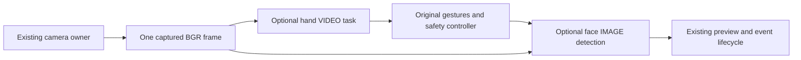

# Phase 4.1 — Face detection and positioning

Phase 4.1 adds opt-in face detection to the existing single-camera application.
It supports hand-only, face-only and combined processing, current-frame face
geometry and preview overlays. No recognition of identity, persistent face IDs,
tracking/prediction, pose, digital reframing, motor, voice or Pi functionality.

## Baseline and scope

Started clean on `main`, commit `47420d2f5fb8cb207af6e339b0104f8a231728a7`.
Reconfirmed **766 passing tests** before editing: camera 75, gestures 165,
hand tracking 259, controls 267. Phase 3.11 source, reports and documentation are
preserved. No dependency or camera reconfiguration changes were made. The work
was initially left unstaged for review; the owner subsequently authorized
committing and pushing Phase 4.1 using DarshP-Dev. Remaining physical acceptance
limits are documented below.

## Detector and model setup

Selected the installed MediaPipe **1.1.1 FaceDetector**, BlazeFace short-range
float16 v1, synchronous CPU **IMAGE** mode. This API is already available with the
current Python 3.13/OpenCV/MediaPipe dependencies. IMAGE mode runs independent
detection on each input, avoiding temporal result reuse or an asynchronous callback.
The existing hand task stays CPU VIDEO mode with its original resolution/settings.

Google's [Face Detector guide](https://developers.google.com/edge/mediapipe/solutions/vision/face_detector)
describes a compact webcam/short-range model supporting multiple faces. A mesh/
landmarker would add unrequested capabilities/work. Other detector architectures
were not benchmarked; selection is based on existing Tasks compatibility and the
measured approximately 2–3 ms CPU face inference here, not an unmeasured accuracy
advantage. See [face_tracking/README.md](face_tracking/README.md) for provenance,
Apache-2.0 model-card licensing, asset URL, version and SHA-256.

```powershell
Set-Location C:\Users\Darsh\VisionControl
.\.venv\Scripts\python.exe -m face_tracking.download_model
```

The explicit setup command downloads Google's pinned 229,746-byte TFLite asset,
verifies its SHA-256, and exclusively creates the local file. Existing files are
verified, never overwritten. The binary is Git-ignored and not redistributed.
Normal startup never downloads; it fails clearly if the enabled face model is
missing/corrupt. Disabled face detection performs no face import, asset read,
task initialization or inference.

## Architecture and ownership



`run()` owns both task lifetimes in its existing ExitStack. Sync capture remains
the default; experimental latest-thread retains its one owning camera worker and
one replaceable immutable snapshot. FaceDetector accepts the already captured
frame and never opens/queries/releases a camera. No additional worker or frame
queue was introduced. Both tasks and all HighGUI work stay on the main thread.

Combined hand input is processed **before face inference**, retaining the original
observation timestamp/freshness checks and avoiding additional face delay before
that frame's control dispatch. Face work does delay the next frame's opportunity,
so its measured cost is included in total processing/frame intervals. Existing
live emergency/watchdog monitoring remains independent of main-thread progress.

Face-only mode does not initialize the hand task or a desktop controller and
rejects hand gesture/track-ID/control flags. Its report marks hand tracking disabled;
the legacy zero-hand histogram is not evidence of running a hand model. The existing
preview window/lifecycle is reused; the visible header identifies face detection.

Default face preparation fits the original frame inside **640×360**, preserving
aspect ratio without cropping, padding, stretching or upscaling. Bounds are
independent of hand inference. An adequate current-frame hand RGB buffer is reused
and resized as needed; a smaller/incompatible hint falls back to the original BGR.
Buffers/model resources are reused across frames, but detection coordinates are not.
The SDK still performs its own task-image copy and fixed network-input preparation.

## Data and coordinate conventions

- `BoundingBox`: continuous `x_min, y_min, x_max, y_max` edges.
- `FaceDetection`: original pixel box, normalized box, pixel/normalized center X/Y, optional confidence,
  pixel offsets and normalized offsets.
- `FaceFrame`: capture-derived timestamp, original/inference dimensions, immutable
  detection tuple, current primary index and `detected`/`no_face`/`expired` status.

Pixel edges use `[0,W]×[0,H]`; preview drawing maps/clamps these to actual display
pixels. Conversion scales SDK input-image boxes into the original image, clips
partly outside boxes, rejects invalid/zero/fully outside boxes, and uses the clipped
visible box center. Dimensions must be positive integers; box/score values must
be finite and valid. Normalized boxes lie in `[0,1]`.

`cx=(left+right)/2`, `cy=(top+bottom)/2`; pixel offsets are `cx-W/2`, `cy-H/2`.
Normalized offsets divide by `W/2`, `H/2`. Negative X means image-left; positive X
image-right. Negative Y means above; positive Y below. Values describe the
unmirrored camera image, independently of cursor inversion. For example,
`FACE 1 | X: +0.24 | Y: -0.08` describes a center right of and above image center.

All valid faces are represented independently. Sorting selects highest available
confidence, then largest clipped area, then ascending box coordinates. Unknown
confidence ranks below known confidence. Identical ties are observationally
equivalent. `FACE 1` is a per-frame rank, not an identity. There is no persistent
selection, name/attribute inference, facial recognition or face-position smoothing.

No-face results are empty and clear the primary. An inference/draw result older
than 250 ms from host read completion is cleared and marked expired; no previous
coordinates are substituted. Reports contain count histograms and durations, not
per-frame face coordinates or saved camera images. Six SDK face keypoints are not
used for pose or identification.

## CLI and preview

| Option | Default / behavior |
| --- | --- |
| `--face-detection` | Off; adds faces to existing hand processing |
| `--face-only` | Implies face detection; skips the hand model and forbids controls/hand gestures |
| `--face-model PATH` | Local verified official v1 asset |
| `--face-inference-resolution WIDTHxHEIGHT` / `full` | 640×360 bounds; separate from hand resolution |
| `--face-min-confidence` | .5, finite in `[0,1]` |
| `--face-overlay` / `--no-face-overlay` | On when faces enabled; disabling drawing does not skip inference |

Each visible face gets a thin box, center dot and available confidence. The primary
gets an image-center line and compact bottom offset label. Existing hand landmarks,
gesture indicators and top control rows remain. Empty/expired face results draw
an appropriate status rather than stale boxes. Minimized/hidden previews skip all
overlay/display work while both models continue. Post-face event pumping catches
X/Q/D queued during detection before drawing; X/Q shut down normally. Restore
uses a new frame; there is no model reinitialization or accumulated image queue.

`--windows-timer-policy system` remains default. `honor-requests` is explicitly
opted into for minimized testing, with the original process masks restored after
camera/model/input cleanup. Face detection never enables that policy implicitly.

## Real hardware measurements

Actual UGREEN/MSMF runs, requested/delivered 1920×1080 BGR at requested 60 FPS,
full-resolution hand inference, latest-thread capture. The driver still rejects
the MJPG request; transport, unique sensor exposures and sensor-to-input age remain
unverified. No exposure, autofocus or backend adjustment was made. No images were
saved and no real Windows input was enabled. Model/worker cleanup succeeded in
every recorded run; all capture/read/stale-result failure counters were zero.

Headless runs used 5 s warmup after first frame and 20 s measurement. The preview
run measured 60 s with 20 s visible, 20 s minimized, 20 s restored and explicitly
selected honor-requests. These are single sessions with varying poses and scene/
background conditions, not controlled accuracy scores or statistical guarantees.

| Workload | App/delivery FPS | Hand mean ms | Face inference mean / P95 / P99 ms | Face total mean ms | CPU, % of one core | Working set MiB |
| --- | ---: | ---: | --- | ---: | ---: | ---: |
| Camera only | 60.04 | — | — | — | 112.64 | 139.13 |
| Hand/gestures only, headless | 41.85 | 20.00 | — | — | 282.87 | 265.87 |
| Face only, 640×360, repeat | 59.84 | — | 2.06 / 2.47 / 2.74 | 3.18 | 156.46 | 233.25 |
| Face only, full image | 60.04 | — | 2.67 / 3.18 / 3.44 | 4.73 | 227.38 | 227.87 |
| Combined, headless | 39.22 | 18.50 | 2.15 / 3.04 / 3.38 | 3.32 | 287.41 | 296.31 |
| Combined, visible/minimized/restored | 30.77 | 21.70 | 2.26 / 3.20 / 3.71 | 3.82 | 288.74 | 314.29 |

Observed workloads, which limit comparison:

- Hand-only: two hands in all 838 frames.
- Face-only 640 repeat: one emitted face in all 1,197 frames. The earlier 640 run
  saw 1,128 empty and 72 one-face frames; it is retained but is not the primary
  face-present result.
- Face-only full: one face in 1,049/1,201 frames, empty in 152. This differs from
  the repeat's scene/pose/population. Lower resolution is not claimed more accurate.
- Combined headless: one face in all 785 frames; two hands in 537, one in 35,
  zero in 213. Its 39.22 FPS is **not** a sustained matched two-hand FPS claim.
- Combined preview: at least one emitted face in all 1,847 frames; two hands in
  1,773 (96.0%) and one hand in 74. The model emitted two faces in 16 frames;
  human confirmation of a real second face versus false positives is pending.

The full-input face task had about 49% greater total face work than the default
repeat (4.73 versus 3.18 ms) and both were capture-limited near 60 FPS. Because
pose/populations differ, this establishes cost evidence, not a quality comparison.
The fixed 128×128 model and reduced task-image copy make 640×360 a reasonable
default. No cadence reduction, stale reuse or thresholds were used to reach FPS.

Face initialization measured about .59–.60 s in the cold face-only processes
(including MediaPipe import) versus .005–.006 s after the hand task already imported
the runtime. These are different startup contexts; do not present them as an init
optimization. Native runtime alignment/copy messages are retained in logs; no
dependency/native inference change was attempted to suppress them.

| Frame pacing and face host age | Headless hands | Headless combined | Combined preview |
| --- | ---: | ---: | ---: |
| Frame interval P95 / P99 ms | 26.50 / 29.65 | 29.90 / 34.13 | 36.67 / 43.99 |
| Mean face host age at completion ms | — | 33.43 | 40.37 |
| Face host-age P95 / P99 ms | — | 43.70 / 51.84 | 53.11 / 59.00 |

Preview-state measurements (include all completed state populations): focused
30.93 FPS, minimized 30.46 FPS. Frame-interval P95/P99 were 35.77/39.48 ms focused
and 42.54/46.18 ms minimized. Face inference mean was 2.14/2.49 ms, with mean face
host age 39.46/42.22 ms. All 609 minimized completed frames skipped rendering.
Steady producer buckets delivered 60.00 focused and 59.94 minimized FPS. Some
minimized frames lost one hand, so fully matched sustained two-hand minimized
acceptance still deserves an owner repeat. No >100 ms completed-frame stalls or
expired face results were recorded. No cursor input was enabled; dispatch timing
and live cursor feel are not claimed.

Raw reports remain under ignored `hand_tracking/benchmarks/phase4_1_*.json`.
`performance_reports/phase4_1.json` preserves exact numeric JSON compressed with
SHA-256 hashes, readable summaries, source hashes and the owned-window benchmark
runner. No Phase 3 report was overwritten. Later test/report/cleanup refinements
do not change the recorded detector/inference settings; actual report populations
take precedence over the intended benchmark scene.

## Automated validation and safety

**806 passing tests**: camera 75, gestures 165, hand tracking 259, controls 267,
new face suite 40. The 766-test regression baseline is preserved. New cases cover
geometry, clipping/finite validation, scores, deterministic multi-face selection,
empty/loss results, initialization/cleanup/native faults, explicit verified model
setup, buffer reuse/RGB/aspect, overlay loss, expiry, disabled lazy path, face-only
restrictions, combined shared worker, minimize/restore, one camera owner and X
cleanup of both models. Tests use fake tasks/cameras and synthetic frames, with
virtual backends only. They do not measure real face accuracy.

All desktop actions still go through the unchanged hand safety controller. Face
objects have no input references and cannot arm, move, click or send keys. A face
exception fails the application closed through existing disarm/held-button release,
source stop and ExitStack cleanup; it is not a reason to keep old coordinates.
The 250 ms hand/capture freshness checks, 500 ms watchdog, global Ctrl+Shift+F10
support, cancellation generations, loss/rearm policies, startup-disarmed behavior,
manual A/D and three/four-hand control restrictions are unchanged. Camera/model
faults never create a second capture. The native MSMF blocking-read/shutdown limit
and existing unreleased-device quarantine remain.

## Owner acceptance commands

Use the existing environment; explicit model setup is needed once. Each timestamp
produces fresh filenames. Keep lighting, camera position, hand/face pose and load
consistent, and repeat/reverse workload order for stronger performance comparison.

```powershell
Set-Location C:\Users\Darsh\VisionControl
.\.venv\Scripts\python.exe -m face_tracking.download_model
$phase41Tag = Get-Date -Format 'yyyyMMdd_HHmmss_fff'

# Existing hand-only behavior.
.\.venv\Scripts\python.exe -m hand_tracking.hand_tracker

# One face, position/signs, loss/recovery, then multiple faces if available.
.\.venv\Scripts\python.exe -m hand_tracking.hand_tracker --face-only --capture-pipeline latest-thread --windows-timer-policy honor-requests --benchmark --warmup 5 --duration 120 --report "hand_tracking/benchmarks/owner_4_1_faces_${phase41Tag}.json"

# Both models, TWO hands and at least ONE face; no controls.
# Visible 0–30s, unfocused 30–60s, minimized 60–90s, restored 90–120s.
.\.venv\Scripts\python.exe -m hand_tracking.hand_tracker --face-detection --capture-pipeline latest-thread --windows-timer-policy honor-requests --gestures --pinch --gesture-states --swipes --benchmark --warmup 5 --duration 120 --report "hand_tracking/benchmarks/owner_4_1_combined_${phase41Tag}.json"

# Gesture compatibility: SIMULATION, starts DISARMED. Press A yourself, D disarms.
.\.venv\Scripts\python.exe -m hand_tracking.hand_tracker --face-detection --capture-pipeline latest-thread --windows-timer-policy honor-requests --gestures --pinch --gesture-states --swipes --controls --control-mode simulate --control-gesture-profile palm-cursor --control-mapping absolute --control-mouse --control-tabs --control-gesture-rearm --control-emergency-hotkey ctrl+shift+f10 --performance-profile --report "hand_tracking/benchmarks/owner_4_1_sim_${phase41Tag}.json"

# Repeat the raw model workloads with no HighGUI and no input. Hold the same scene.
foreach ($phase41Mode in 'hands','faces','combined') {
  $phase41Extra = @()
  if ($phase41Mode -eq 'faces') { $phase41Extra = @('--face-only') }
  if ($phase41Mode -eq 'combined') { $phase41Extra = @('--face-detection') }
  .\.venv\Scripts\python.exe -m hand_tracking.hand_tracker @phase41Extra --capture-pipeline latest-thread --headless --benchmark --warmup 5 --duration 30 --report "hand_tracking/benchmarks/owner_4_1_${phase41Mode}_${phase41Tag}.json"
}
.\.venv\Scripts\python.exe -m camera.benchmark_delivery --capture-pipeline latest-thread --warmup 5 --duration 30 --report "hand_tracking/benchmarks/owner_4_1_camera_${phase41Tag}.json"

# Face-resolution cost comparison; hand resolution is unaffected.
.\.venv\Scripts\python.exe -m hand_tracking.hand_tracker --face-only --face-inference-resolution full --capture-pipeline latest-thread --headless --benchmark --warmup 5 --duration 30 --report "hand_tracking/benchmarks/owner_4_1_face_full_${phase41Tag}.json"

.\.venv\Scripts\python.exe -m unittest discover -s camera -q
.\.venv\Scripts\python.exe -m unittest discover -s gestures/tests -t . -q
.\.venv\Scripts\python.exe -m unittest discover -s hand_tracking -t . -q
.\.venv\Scripts\python.exe -m unittest discover -s controls/tests -t . -q
.\.venv\Scripts\python.exe -m unittest discover -s face_tracking/tests -t . -q
```

Time states from the warmup-complete message and inspect actual state residency,
not just the intended schedule. Repeat with `--capture-pipeline sync` to verify
the default fallback. Add `--no-face-overlay` to isolate drawing cost, or change
only face bounds to compare preprocessing. Do not interpret empty-scene versus
two-hand/one-face differences as optimizations.

Visually confirm box alignment, center and X/Y direction while moving. Leave the
frame, verify FACE none, return, then introduce a second face and verify separate
boxes and current-frame ranking. Minimize/restore and close X; verify cleanup.
In simulation, manually arm and test palm/pointing/fist, pinch click/drag/release,
swipes, loss/reacquisition, left-pinch rearm/resume and D/Q/X while virtually dragging.
Face appearance/loss must never arm or issue actions. Simulation does not register
a real global hotkey; live hotkey/desktop acceptance remains separate and no live
test was performed. Physical box/offset accuracy, confirmed multi-person behavior,
complete loss/recovery scenarios and those simulated interactions remain pending
owner confirmation despite real model/preview runs.

## Files and Phase 4.2 boundary

Created the `face_tracking/` package (`face_detector.py`, `face_geometry.py`,
`face_models.py`, `preview.py`, `download_model.py`, README and tests), this report
and the numeric evidence artifact. Modified `.gitignore`, root/tracking READMEs,
`hand_tracking/hand_tracker.py`, `hand_tracking/tracking_utils.py` and the existing
timeline's allowed stage names. Controller, gesture, capture-owner and dependency
implementations were not rewritten.

For Phase 4.2, a separate continuity component can consume immutable timestamped
FaceFrames and explicitly manage target loss/association. Current `primary_index`
must not be mistaken for a track ID. Detection geometry and camera ownership can
stay shared. Identity recognition, prediction, reframing and motor commands remain
outside this phase; none were implemented. Commit message:
`feat(visioncontrol): add real-time face detection and positioning`.
